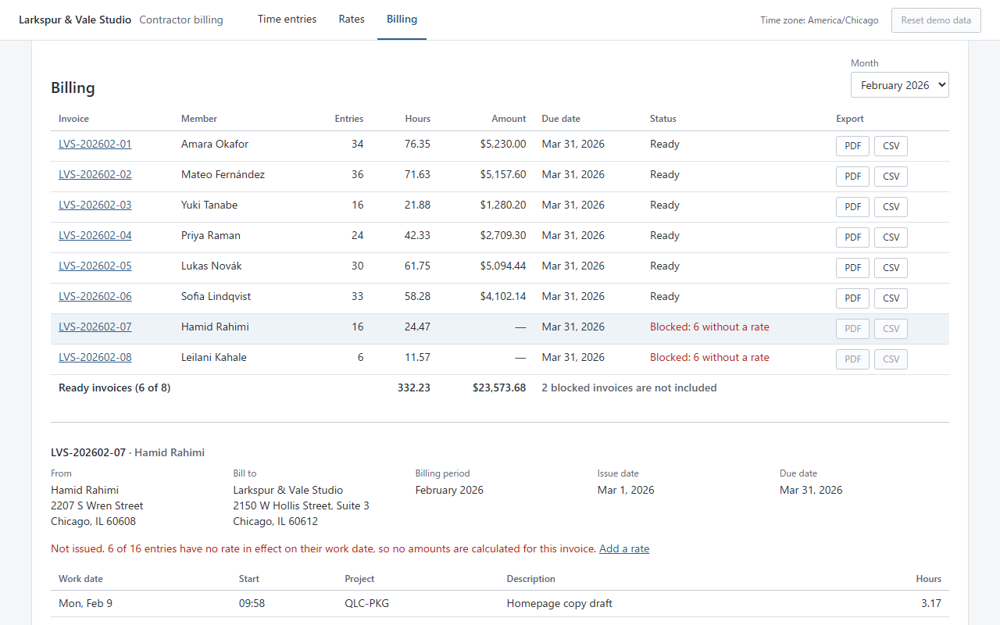
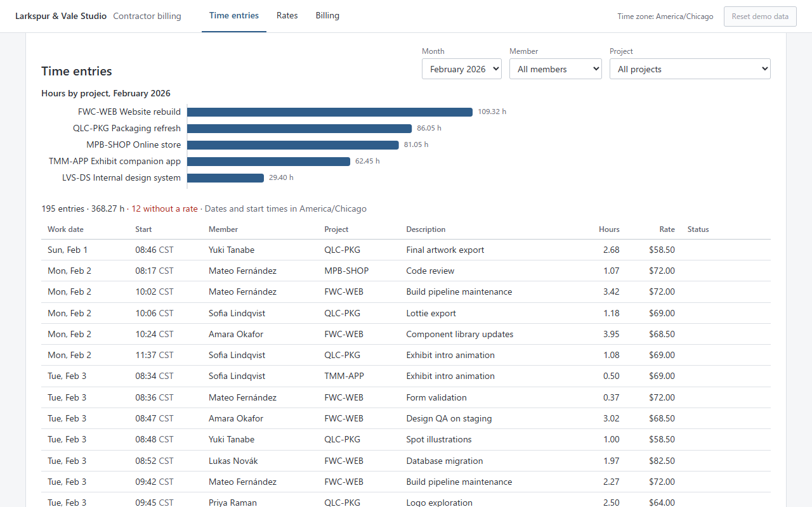
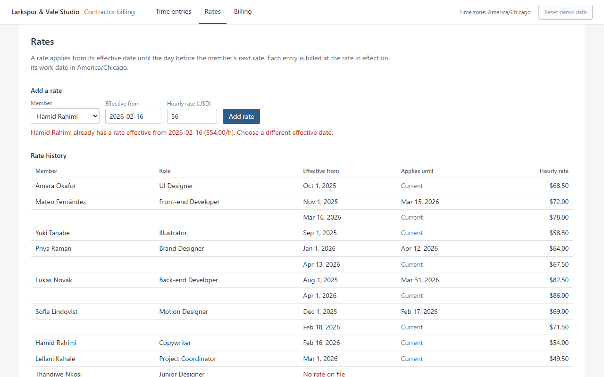
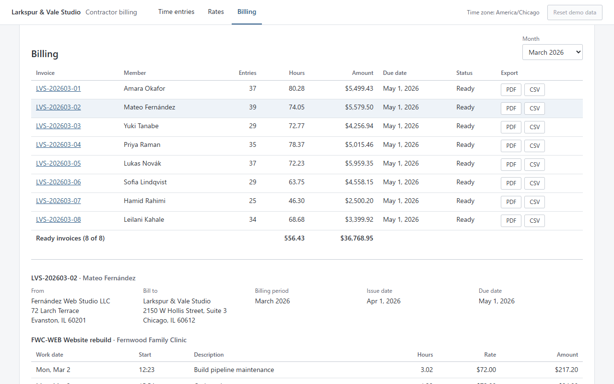
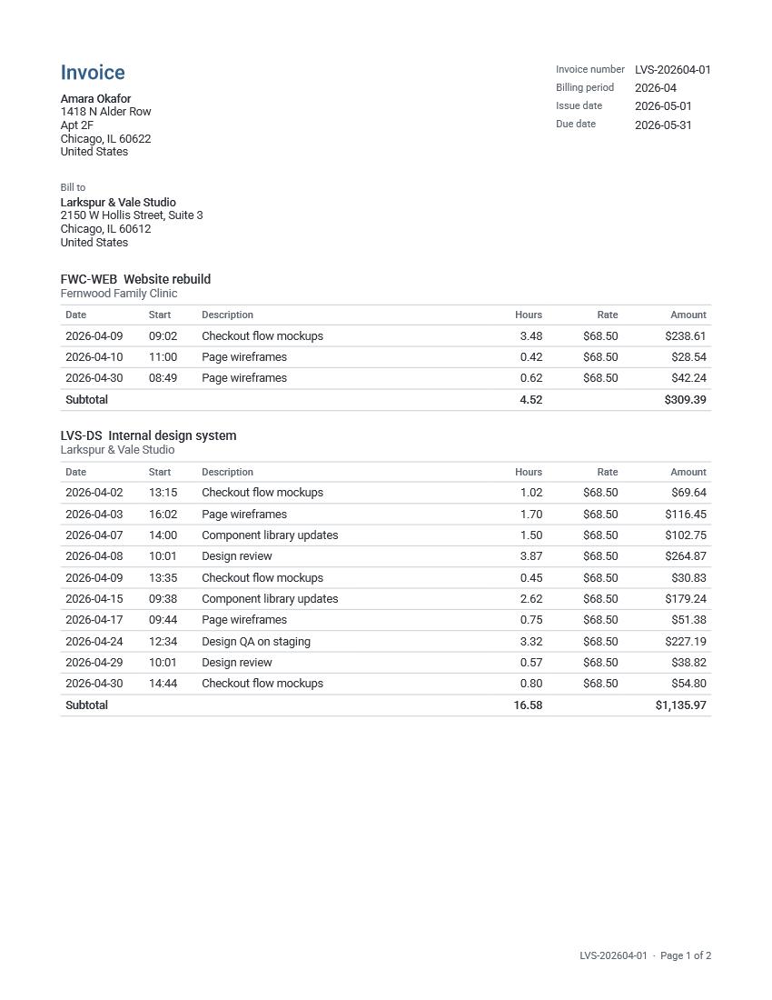

# Contractor billing demo

**Live demo:** https://ryotaarakawagogo.github.io/timesheet-billing-demo/

Monthly invoicing for contractors whose hourly rates change over time. The tool matches every time entry to the rate in effect on its work date, calculates each contractor's monthly invoice, and exports it as a PDF invoice and a CSV detail file. Both files are built from the same calculation result.

The setting is a fictional design and web studio with nine contractors. **All data is fictional** (see [About the data](#about-the-data)).



## The problem

Billing contractors by the hour looks simple until rates change. The mistakes are quiet: nothing crashes, but a number is wrong.

- A rate changes in the middle of the month, and some entries are billed at the wrong side of the change.
- Work starts before anyone has registered a rate, and the entries are billed at $0 or at an unrelated rate.
- The PDF and the CSV are generated by separate code paths. One of them is updated, the other is not, and the two files disagree.
- Time is stored in UTC, but "which day" and "which month" are business questions in local time. Late-evening work ends up on the wrong day, at the wrong rate, or in the wrong month.

## Features

1. **Members and rate history.** Each contractor has rates with an effective date, including changes in the middle of a month. You can add a rate in the browser; a second rate on the same effective date is rejected with a message.
2. **Monthly invoice calculation.** Each entry is billed at the rate in effect on its local work date. If any entry has no rate, the invoice is **blocked**: no amounts are shown, and the entries that caused it are listed.
3. **PDF invoice and CSV detail.** Both are formatted from one `InvoiceResult`. Tests read both files back and check that every line, subtotal and total match.
4. **Explicit time zone.** The company time zone (`America/Chicago`) is a setting. Deciding the work date and the billing month happens in one function, always in that zone.

| Time entries | Rates |
|---|---|
|  |  |

| Billing (ready) | Invoice PDF |
|---|---|
|  |  |

## Pitfalls reproduced in the data, and how they are prevented

The seed data contains real cases of each pitfall. The test names below are the actual names in the test suite.

### 1. Work logged before a rate exists

Two contractors started working before their first rate was registered (Feb 9 and Feb 23), and a new joiner has no rate yet. A naive implementation bills those entries at $0, or at whatever rate it finds next.

**Prevention:** `resolveRate` returns `null`, never 0. One entry without a rate blocks the whole invoice. The blocked invoice has no amounts, lists the offending entries, and refuses to export.

Tests (`tests/billing.test.ts`):

- `[Pitfall: rate missing] work logged before a rate exists stops the invoice > m07 2026-02 is blocked with the 6 offending entries listed (started Feb 9, first rate from Feb 16)`
- `… > m08 2026-02 is blocked with the 6 offending entries listed (started Feb 23, first rate from Mar 1)`
- `… > m09 2026-04 is blocked with the 4 offending entries listed (joined Apr 29, no rate registered)`
- `… > registering the missing rate unblocks the invoice and bills those entries at that rate`
- `outputs refuse a blocked invoice > CSV is not produced … / PDF is not produced when the invoice is blocked` (`tests/exports.test.ts`)

### 2. Output formats drift apart

Suppose the rule for choosing a rate changes, from "the rate when the contractor started" to "the rate in effect on the work date". If only the PDF code is updated, the CSV keeps the old rule, and the same month has two different totals.

**Prevention:** amounts are calculated in exactly one place (`src/domain/billing.ts`). `src/export/pdf.ts` and `src/export/csv.ts` only format the `InvoiceResult`. The tests parse the CSV text and walk the pdfmake document definition, then compare them line by line for every ready invoice in the data (22 invoices).

Tests (`tests/exports.test.ts`):

- `[Pitfall: output formats drift] PDF and CSV come from one calculation and match > PDF and CSV have the same lines, in the same order, with the same rate and amount`
- `… > PDF and CSV have the same project subtotals and the same total`
- `… > both totals equal the calculation result, and the CSV lines add up to it`

### 3. Time-zone boundaries

Entries are stored as UTC instants. Chicago is UTC−6 (CST) or UTC−5 (CDT), so an entry started at 23:30 local time has the *next* day's UTC date. If the day is taken from the UTC timestamp, that entry gets the next day's rate, or lands in the next month's invoice.

**Prevention:** `workDateOf` and `billingMonthOf` in `src/domain/dates.ts` are the only functions that decide a day or month, and they always convert to the company zone first. Every case below is a real entry in the seed data. Each test first shows that the UTC date really gives a different answer, then checks that the invoice uses the local one.

Tests (`tests/timezone.test.ts`), **rate chosen by the local work date**:

- `te-0113: Feb 17 23:45 CST is billed at the Feb 17 rate $69.00, not the Feb 18 rate $71.50`
- `te-0195: Feb 28 23:30 CST is Rate missing (first rate starts Mar 1); a UTC date would wrongly find $49.50`
- `te-0322: Mar 15 23:35 CDT is billed at the Mar 15 rate $72.00, not the Mar 16 rate $78.00`
- `te-0460: Mar 31 23:40 CDT is billed at the March rate $82.50, not the Apr 1 rate $86.00`
- `te-0557: Apr 12 23:15 CDT is billed at the Apr 12 rate $64.00, not the Apr 13 rate $67.50`

**Billing month decided by the local work date**:

- `te-0194: Feb 28 23:20 CST belongs to the February invoice, not March`
- `te-0195: Feb 28 23:30 CST blocks the February invoice (Rate missing) and does not leak into March`
- `te-0460: Mar 31 23:40 CDT belongs to the March invoice, not April`
- `te-0719: Apr 30 23:10 CDT belongs to the April invoice, not May (outside the data period)`

**Daylight saving time (starts Mar 8, 2026)**:

- `te-0259: Mar 7 23:30 CST (UTC-6, night before DST) stays on Mar 7`
- `te-0260: Mar 8 01:15 CST, spanning the 02:00 -> 03:00 jump, is on Mar 8 and keeps its 60 minutes`
- `te-0261: Mar 8 20:50 CDT (UTC-5, first evening after DST) stays on Mar 8`

## Calculation rules

| Topic | Rule |
|---|---|
| Work date | Local date of the entry's **start** in the company zone. An entry that runs past midnight belongs to the day it started. |
| Billing month | Year and month of the work date. |
| Rate | The member's rate with the latest `effectiveFrom` that is on or before the work date. A rate applies until the day before the member's next rate. Two rates with the same effective date are rejected as a data error. |
| Missing rate | No rate on or before the work date: the entry is *Rate missing*, and the invoice is blocked. |
| Amount per line | `round_half_up(minutes × hourly rate in cents / 60)`, in integer cents. No floating point is used for money. |
| Subtotal and total | Project subtotal = sum of its line amounts. Invoice total = sum of subtotals. Because rounding happens per line, the lines always add up to the total. |
| Hours shown | Minutes ÷ 60, rounded half up to 2 decimals, for display only. Amounts are calculated from minutes, not from the rounded hours. |
| Invoice | One per contractor per month, with lines grouped by project (ordered by project code). Issue date is the 1st of the next month; the due date is `paymentTermsDays` (30) later. |
| Rate lookup timing | Rates are looked up each time an invoice is calculated, so adding a rate changes the result immediately. See [Limitations](#limitations). |
| Display | Screens and files are always in English (en-US), whatever language the browser uses. Screens show readable dates (`Mon, Mar 16`); PDF and CSV use ISO dates (`2026-03-16`). |

## Tech stack

- TypeScript, React 19, Vite 8
- [Luxon](https://moment.github.io/luxon/) for time zones. Chosen because it converts to an IANA zone with an explicit locale and handles DST using the browser's built-in `Intl` data.
- [pdfmake](https://pdfmake.github.io/docs/) for PDFs in the browser. Chosen because a document is a plain data structure, so tests can compare it with the CSV without rendering. It is loaded only when the first PDF is requested.
- Vitest for tests. The domain modules (`src/domain`, `src/export`) do not import React.
- GitHub Actions for CI and deployment to GitHub Pages, with no secrets.

```
src/domain/    dates, rates, money, billing   (no UI code)
src/export/    csv.ts, pdf.ts                  (format an InvoiceResult, no calculation)
src/ui/        React screens
src/data/seed/ generated JSON bundled with the app
scripts/       generate-data.ts
tests/         Vitest suites and fixtures/scenarios.json
```

## Running it

Requires Node.js 22.18 or later (the data generator runs TypeScript directly).

```bash
npm ci
npm run dev            # http://localhost:5173
npm test               # unit tests
npm run typecheck
npm run build          # static site in dist/
npm run preview        # serve dist/ locally
npm run generate:data  # regenerate the fictional seed data (same output every time)
```

Rates added in the browser are kept in memory for that tab only. **Reset demo data** or a reload restores the bundled data.

## CI / CD

`.github/workflows/ci.yml` runs on every push and pull request:

1. type check (`tsc --noEmit`)
2. unit tests
3. **data reproducibility:** runs the generator and fails if the committed seed data changes
4. production build

On `main`, it then deploys `dist/` to GitHub Pages. No secrets are used; the deploy job uses the built-in Pages permissions only.

## About the data

All companies, people, addresses and figures in this demo are fictional. Any resemblance to real entities is coincidental.

- **Everything is fictional.** This includes the studio, its clients, the contractors, addresses, projects, rates and time entries.
- The data is created by `scripts/generate-data.ts` with a fixed random seed, so the same files are produced every time. CI checks this.
- Period: Feb 1 – Apr 30, 2026. 9 contractors, 5 projects, 12 rate entries, 719 time entries, most with fractional hours.
- The generator intentionally does **not** use the app's date or rate code. It converts time zones with its own `Intl`-based helper and resolves rates with its own implementation. Because of this, the tests compare the app against an independent source, not against itself.
- The edge cases are hand-placed: mid-month rate changes, work before a first rate, late-night entries on month ends and on the eve of rate changes, and entries around the DST change. `tests/fixtures/scenarios.json` lists them.
- Public holidays are **not** considered. Weekends have occasional entries.

## Limitations

- **PDF page breaks.** A project section of up to 30 lines (other than the first) is moved whole to the next page instead of being split. The first section is allowed to split, so that page 1 is not left almost empty. pdfmake cannot keep the last table row together with the next one, so a split section can still put only its subtotal row at the top of the next page. In the seed data this happens once, in `LVS-202603-02`.
- **Nothing is persisted.** This is a static demo; edits stay in the browser tab.
- **Single time zone.** All contractors are billed in the company zone.

## Future improvements

- **Lock issued invoices.** Today, rates are looked up at calculation time. Adding a rate with a past effective date therefore changes invoices for months that were already sent. A production version would mark an invoice as issued and fix (snapshot) the rate on each entry when it is confirmed. Corrections would then be explicit, with an audit trail.
- Editing time entries, with a required reason.
